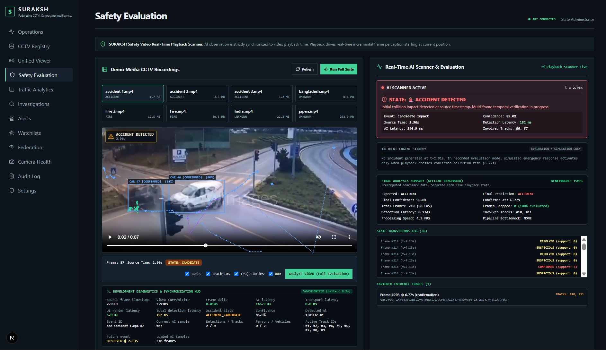
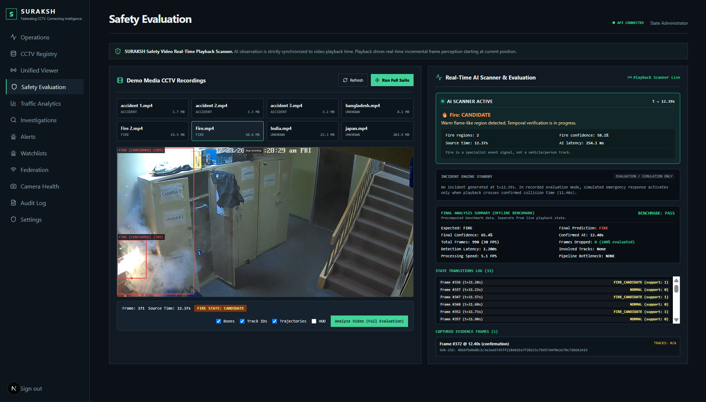
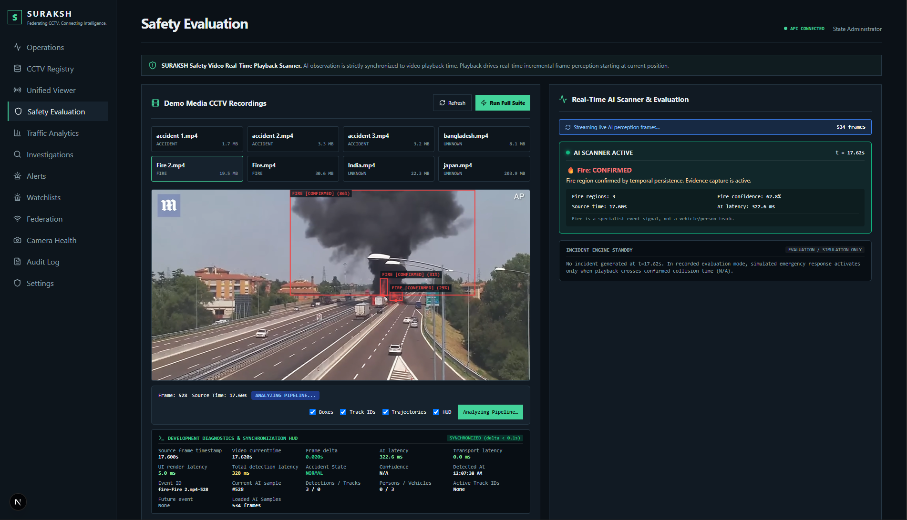
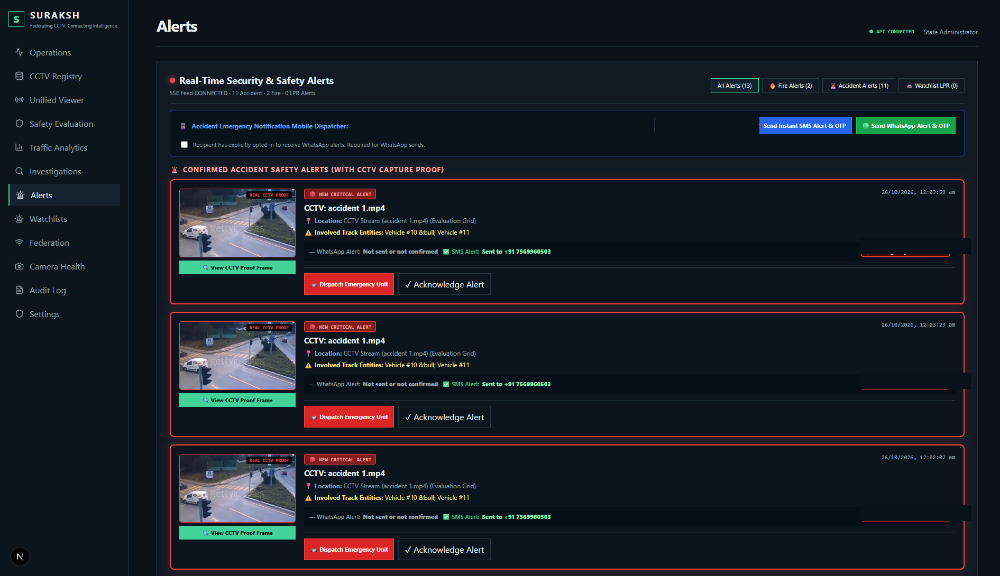

# SURAKSH

<strong>AI-Powered CCTV Safety &amp; Security Intelligence</strong> A development platform for turning video into structured detections, anonymous tracks, safety events, incidents and operational intelligence.

> SURAKSH is an academic and development project. It is not a production safety system until real-world validation, reliability testing and operational acceptance are complete.

## Academic project details

| Field | Information |
| --- | --- |
| Course ID | 21CSC203P |
| Course Name | Advanced Programming Practice |
| Project Title | SURAKSH – AI-Powered Intelligent CCTV Safety & Security Monitoring System |
| Department | Computer Science and Engineering (CSE) |
| Section | A |
| Academic Year | II Year B.Tech (2026–2027) |
| Institution | SRM Institute of Science and Technology, Tiruchirappalli |

### Team members

| S. No. | Full Name | Register Number | Department | Section | Academic Year |
| --- | --- | --- | --- | --- | --- |
| 1 | Bolla Raviteja | RA2511003050026 | Computer Science and Engineering | A | II Year (2026–2027) |
| 2 | D. Praneeth | RA2511003050028 | Computer Science and Engineering | A | II Year (2026–2027) |
| 3 | Bandaru Maheeth | RA2511003050488 | Computer Science and Engineering | A | II Year (2026–2027) |

### Mentor details

- **Mentor's Full Name:** Dr. L. Josephine Usha
- **Designation:** Assistant Professor, Department of Computer Science and Engineering

### APP subject faculty

- **Faculty Name:** Dr. S. Shargunam
- **Designation:** Assistant Professor, Department of Computer Science and Engineering
- **Subject:** 21CSC203P – Advanced Programming Practice

## Project status

| Area | Current status |
| --- | --- |
| Control-room frontend | Implemented |
| Backend API, authentication and RBAC | Implemented |
| Camera registry, VMS metadata and audit log | Implemented |
| Person and vehicle detection | Implemented |
| Anonymous tracking and counting | Implemented |
| Fire, smoke and accident reasoning | Implemented |
| Number-plate recognition (ANPR/OCR) | Implemented |
| Production readiness | Not yet validated for real-world deployment |

**Status note:** “Implemented” indicates the feature is available in the project's development/demo workflow, as reported by the project team. It does not mean independently verified accuracy, reliability or production certification.

## Why SURAKSH?

Traditional CCTV produces large volumes of video while detection and investigation remain heavily dependent on continuous human monitoring. SURAKSH adds an intelligence layer that can detect objects, maintain anonymous tracks, count movement, analyse trajectories, generate safety events and connect evidence to operational workflows.

The platform is designed as a federation layer above departmental video management systems. The local demo uses synthetic records and local media so control-room flows can be exercised without claiming statewide coverage or production accuracy.

## Architecture

~~~mermaid
flowchart LR
    A[CCTV / RTSP / Recorded video] --> B[Edge Agent]
    B --> C[Frame acquisition and buffering]
    C --> D[AI detection]
    D --> E[Multi-object tracking]
    E --> F[Counting and temporal analysis]
    F --> G[Safety and vehicle event services]
    G --> H[Backend API]
    H --> I[(PostgreSQL / PostGIS)]
    H --> J[Alerts, incidents and audit records]
    H --> K[Frontend control room]
~~~

~~~text
CCTV / VIDEO → VIDEO ACQUISITION → EDGE AI → DETECTION
→ MULTI-OBJECT TRACKING → TRAJECTORY / TEMPORAL ANALYSIS
→ EVENT DETECTION → INCIDENT ENGINE → ALERTS / EVIDENCE → DASHBOARD
~~~

## AI perception pipeline

The pipeline separates visible-object detection from identity continuity and event interpretation:

1. Frame acquisition reads configured video sources and manages the latest-frame path.
2. Preprocessing prepares frames for the selected local inference provider.
3. Object detection produces candidate person and vehicle observations.
4. Detection filtering applies class, confidence and scene rules.
5. Multi-object tracking associates observations over time.
6. Track lifecycle management represents confirmed, lost and removed tracks where supported.
7. Motion and trajectory services retain bounded temporal history.
8. Counting derives visible, unique and line-crossing aggregates.
9. Temporal event reasoning combines evidence across frames.
10. Incident services persist structured events and evidence references.
11. The API exposes operational state to the dashboard.

Detection answers “what objects are visible?” Tracking answers “which detection belongs to the same object over time?” Temporal reasoning answers “what is happening across multiple frames?”

## Tracking and counting

SURAKSH uses anonymous, session-local track identifiers and keeps camera streams isolated. The repository contains tracker adapters, lifecycle contracts, line-crossing and zone/counting foundations, timestamp-aware replay handling, bounded queues and runtime telemetry. Tracking quality depends on camera angle, resolution, occlusion, lighting, object size, motion, detector quality and available compute. The project does not claim perfect identity continuity or counting accuracy.

## Safety intelligence

The project team reports that fire detection, smoke detection and accident reasoning have been implemented and are working in the development/demo workflow. Fire and smoke paths use candidate detection and temporal confirmation; accident reasoning combines trajectory, motion, interaction and temporal evidence. These implementations still require independently measured accuracy, false-alarm and real-world reliability validation before production use.

## Vehicle intelligence

The modular number-plate path is:

~~~text
Vehicle detection → Vehicle tracking → Plate detection → Quality gate
→ Crop/enhancement → Replaceable OCR → Validation → Multi-frame consensus
~~~

The project team reports that number-plate recognition is implemented and working in the development/demo workflow. The recognition pipeline and its components reside in backend/app/anpr, with replaceable detector and OCR providers. OCR performance remains dependent on the runtime environment, and annotated accuracy evaluation is still pending. SURAKSH does not identify vehicle owners.

## Backend platform

The FastAPI backend provides REST endpoints for authentication, users, departments, cameras, VMS integrations, detections, watchlists, alerts, analytics, incidents, notifications, registry health and audit records. SQLAlchemy and Alembic manage PostgreSQL/PostGIS persistence. Realtime alert delivery is implemented through the alert stream endpoint. See docs/API.md, docs/ARCHITECTURE.md and docs/SECURITY.md.

## Edge Agent

The Edge Agent keeps video processing near the source and avoids making the backend responsible for every raw frame. It contains frame-source, detector, tracker, analytics, promotion and backend-client modules. The implementation includes local processing foundations, camera isolation, bounded buffering and runtime telemetry. Provider availability, hardware acceleration and offline delivery behavior depend on configuration and environment.

~~~text
Camera → Edge Agent → Local AI processing → Structured events → Backend
~~~

## Technology stack

| Layer | Technology | Purpose |
| --- | --- | --- |
| Frontend | Next.js, React, TypeScript | Control-room dashboard and operational views |
| Backend | Python, FastAPI, SQLAlchemy | API, authentication and domain services |
| Database | PostgreSQL, PostGIS, Alembic | Relational and geographic persistence |
| Edge AI | Python, OpenCV, Ultralytics | Local frame processing and detector integration |
| OCR | Tesseract/PaddleOCR integration points | Replaceable plate recognition providers |
| Streaming | RTSP foundations, HLS.js, MediaMTX compose service | Camera and replay delivery |
| Testing | Pytest, TypeScript compiler, ESLint | Software correctness and frontend checks |
| Operations | Docker Compose, Uvicorn, Next.js | Local multi-service development |

## Repository structure

~~~text
CC/
├── backend/          FastAPI application, models, migrations and tests
├── edge-ai/          Local frame processing, perception, tracking and analytics
├── frontend/         Next.js control-room application
├── docs/             Architecture, safety, tracking, ANPR, API and evidence
├── scripts/          Runtime, replay, benchmark and verification utilities
├── simulators/       Synthetic VMS simulator services
├── infra/            Local backend deployment configuration
├── demo-media/       Demo media metadata and setup documentation
├── docker-compose.yml Local service topology
├── .env.example      Placeholder configuration only
└── README.md         This document
~~~

## Local development

Verified local requirements are Python with backend dependencies, Node.js with frontend dependencies, and Docker Desktop for the full compose topology.

~~~powershell
git clone https://github.com/ravitejabolla756-sys/RA2511003050026_APP_Project_Nov_26.git
cd Suraksh
Copy-Item .env.example .env
# Replace development placeholders in .env with local values.
docker compose up --build
~~~

For the lightweight local demo:

~~~powershell
python scripts/local_runtime.py
cd frontend
npm install
npm run dev
~~~

The control room is served at http://localhost:3000, OpenAPI at http://localhost:8000/docs, and health at http://localhost:8000/health. The seeded demo login is local-only: admin@suraksh.demo / Suraksh123! when demo seeding is enabled.

## Configuration

Copy .env.example to .env and provide local values for the database URL, JWT secret, edge ingest key, CORS origins and demo flags. The Edge Agent reads YAML configuration under edge-ai/config/; model selection is controlled by the configured local model path. Do not place credentials, private RTSP URLs or private video data in Git.

## Demo

The local demo covers the control-room dashboard, synthetic camera registry, GIS markers, VMS metadata, recorded replay, vehicle search, watchlists, alerts, audit records and camera health. Prepared local demo media can be used when available. Demo records are synthetic.

## Implementation matrix

| Capability | Status |
| --- | --- |
| Organizations, authentication and RBAC | Implemented |
| Camera and VMS metadata management | Implemented |
| RTSP and HLS foundations | Partial; environment dependent |
| Person detection | Implemented |
| Vehicle detection | Implemented |
| Anonymous tracking | Implemented |
| Counting and line/zone concepts | Implemented (demo; accuracy validation pending) |
| Fire and smoke | Implemented (demo; accuracy validation pending) |
| Accident reasoning | Implemented (demo; accuracy validation pending) |
| Number-plate recognition (ANPR/OCR) | Implemented (demo; OCR validation pending) |
| Recording, retention and playback | Replay foundation; production retention pending |
| Search, incidents and alerts | Implemented |
| Notifications and auditability | Implemented |
| Runtime telemetry | Implemented |
| NVIDIA acceleration | Environment/configuration dependent |
| OpenVINO | Not established as a current default |
| Live video wall | Partial local viewer |

## Validation and accuracy

Software tests and AI accuracy validation are different gates. Passing unit or integration tests proves software contracts for tested cases; it does not prove detection accuracy in real CCTV conditions.

The repository contains backend and Edge AI Pytest suites, frontend TypeScript and ESLint checks, replay and benchmark scripts, and documented evaluation contracts. Production AI evaluation requires annotated, rights-approved real-world ground truth. Relevant measures include precision, recall, F1, mAP, ID switches, track fragmentation, count error, false-alarm rate, missed-event rate and detection latency. No unverified accuracy number is claimed here.

## Roadmap

Current work focuses on validation and refinement of the implemented control-room, detection, tracking, fire/smoke, accident reasoning and number-plate recognition features. Priorities include annotated accuracy testing, occlusion recovery, motion prediction, more reliable event confirmation, improved OCR performance, evidence clips, timeline search, advanced analytics, multi-camera operations, soak testing and real-world acceptance.

## Security

The backend includes authentication, role checks, organization-scoped access patterns, audit records and protected connector boundaries. Local camera credentials and ingest keys belong in environment configuration. Do not commit secrets, camera credentials, API keys or private video data. No security certification or production authorization is claimed.

## Contributing

Create a focused branch, keep changes scoped, run the relevant backend, Edge and frontend checks, update documentation when behavior changes, and open a pull request with validation evidence. Do not commit generated caches, credentials, private footage or local model weights.

## License

SURAKSH is released under the MIT License.

See the [LICENSE](LICENSE) file for the complete license text.

## Third-Party Licenses

The MIT License applies to the SURAKSH project code owned by the project authors.

Third-party software, AI models, datasets, pretrained weights, libraries, media, and other external assets may be subject to their own licenses and terms. Their respective licenses remain applicable.

The repository identifies the Ultralytics detector integration as AGPL-3.0-or-later and requires a separate enterprise-license review for proprietary deployment. Model checkpoints, OCR packages, FFmpeg images, datasets and other external assets require review of their own license terms before redistribution or deployment. No ownership or MIT licensing is claimed for those materials.

## Disclaimer

SURAKSH is currently an academic/development project and should not be treated as a production safety system until real-world validation, reliability testing and operational acceptance are completed.

## Project Output Screenshots

These captures document the SURAKSH safety-evaluation, fire-detection, and real-time incident-alert interfaces. Phone numbers and one-time passwords visible in the alert capture have been redacted for public repository use.

### Accident detection and tracking

### Fire detection from CCTV footage

### Confirmed fire evaluation

### Real-time incident alerts

